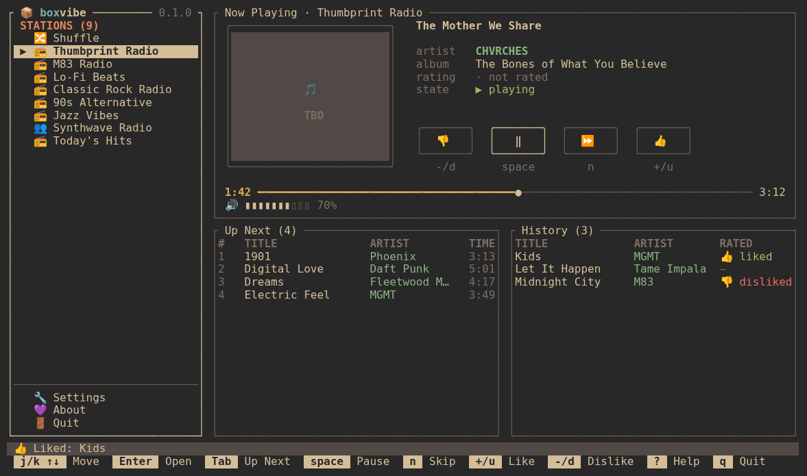
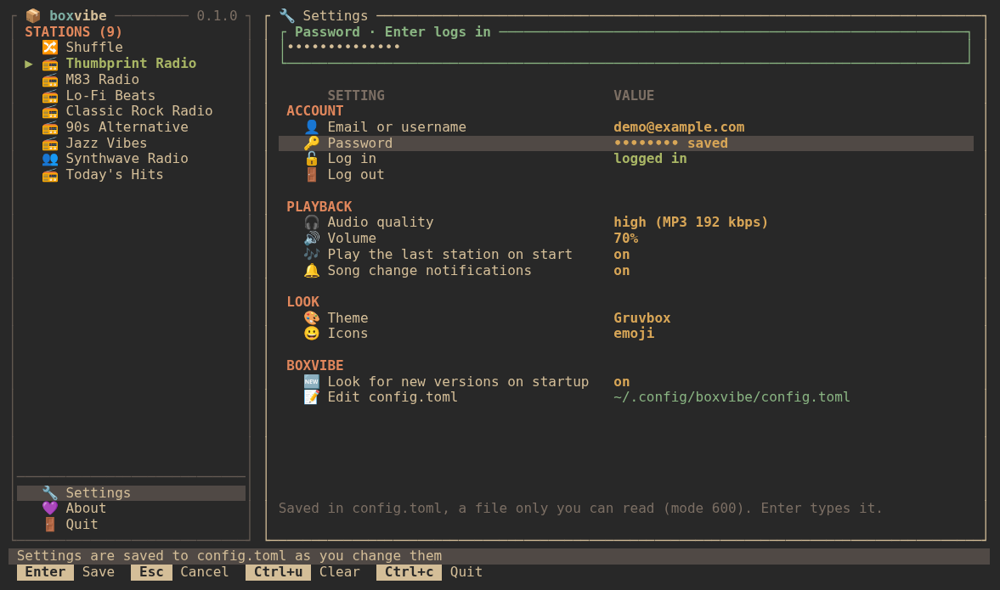
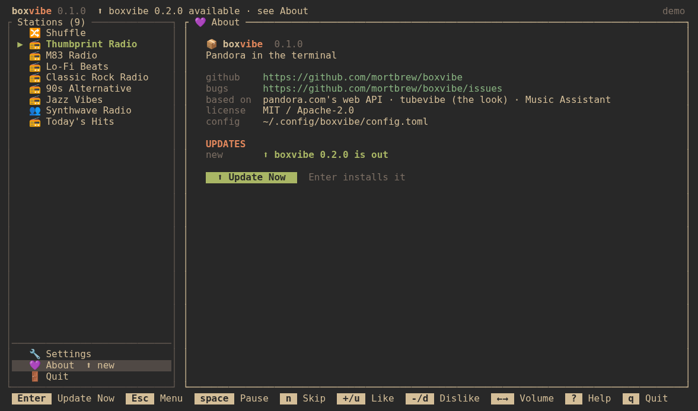
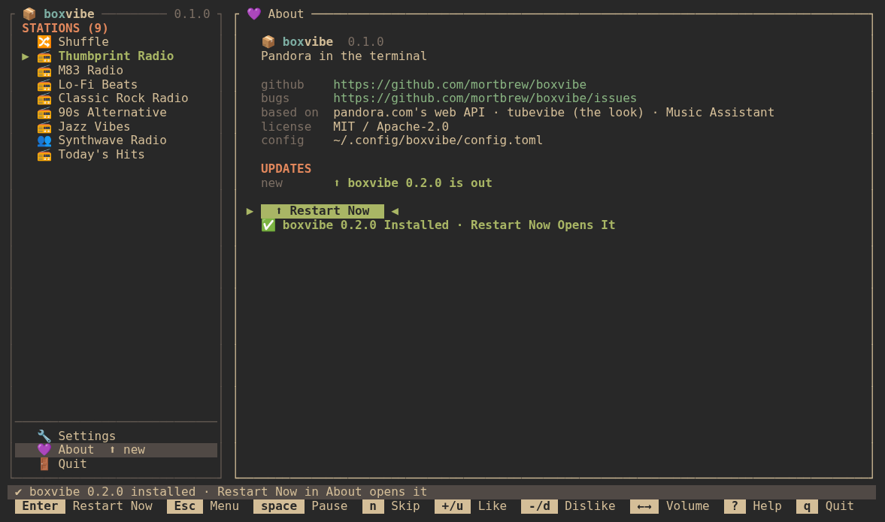

# boxvibe

[](https://github.com/mortbrew/boxvibe/actions/workflows/ci.yml)
[](https://github.com/mortbrew/boxvibe/actions/workflows/codeql.yml)
[](https://github.com/mortbrew/boxvibe/actions/workflows/audit.yml)
[](https://github.com/mortbrew/boxvibe/releases/latest)
[](#license)

Pandora in the terminal, written in Rust with [ratatui](https://ratatui.rs).
A sibling of [tubevibe](https://github.com/mortbrew/tubevibe): the same look,
Omarchy colour sync, icon sets and a `config.toml` that the app keeps up to
date. Titled panels, your stations (then Settings and About) on the left with
the logo and version on its frame, a large CarPlay-style **Now Playing** card
with the four big buttons (thumbs down, play/pause, skip, thumbs up), **Up
Next** and **History** side by side under it, a status bar, and the keys that
work right now drawn as key caps at the bottom.

> Early (0.4.0): it plays your stations and can rename and delete them, but
> search and creating stations are still to come. Feedback welcome.










## What it does

- **Log in inside the app**: the first time, boxvibe opens **Settings** at the
  account section and asks for your Pandora email (or username), then the
  password. The email goes in `~/.config/boxvibe/config.toml` (mode 600); the
  **password goes in your desktop keychain** (any Secret Service one: GNOME
  Keyring, KeePassXC…), never in the file. From then on it logs in by itself.
  The password is asked in a **popup** that says so plainly: where it goes
  (your system keychain, the Secret Service), that it is never written to
  `config.toml` or any other file, and `Enter` / `Esc` for log in / cancel.
  No keychain running? The popup says "No system keychain was found" and that
  the password is kept for this session only (you are asked again each start).
  The popup also says: **"Use at your own risk: boxvibe is not made by Pandora.
  By logging in with boxvibe you accept that neither boxvibe nor its creator is
  responsible if Pandora limits or bans your account."**
  Change the account, forget the saved password or log out in Settings any time
- **Your stations** (Shuffle too) on the left; `Enter` plays one, and the
  last one you played starts again next time
- **Now Playing**: title, artist, album, your thumb, a progress bar with the
  time, and the volume, with three blank columns inside each side of its frame
- **Thumbs up / down** (`U` / `D`, from any pane). Like in Pandora, a thumbs down skips the
  song. **Tired of this song** (`Z`, Shift+z) keeps it off all your stations for a month
- **Up Next** and **History**: the few songs Pandora sent up next on the
  left, the last 10 you heard on the right (stacked on a narrow window). Each pane is
  sized for 10 songs and Now Playing gets the rest of the height; on a short window Now Playing keeps
  9 rows and the song panes shrink and scroll. `Tab` goes menu → Now Playing → Up Next →
  History; `l` / `b` rate the selected row (or the playing song from Now Playing)
- **Settings** (account first, then audio quality, volume, autoplay, song change
  notifications, theme, icons, border style, menu width, update check, the genre station edit popup, edit `config.toml` in `$EDITOR`, app menu entry) and **About**
  (links, version, and the update button) below the stations. Between them,
  **Notifications** lists what the bottom bar said this session, newest first,
  with how long ago (the last 200; `j`/`k` scroll)
- **Updates itself** from GitHub releases: see [Updating](#updating)
- **Gapless-ish playback**: the next song downloads while this one plays.
  MP3 and AAC (MP4) are decoded in Rust ([symphonia](https://github.com/pdeljanov/Symphonia)
  through [rodio](https://github.com/RustAudio/rodio)), no ffmpeg or mpv needed
- **Even loudness**: Pandora's per-song loudness correction (`fileGain`) is applied with your volume, never pushed past full scale. Songs are resampled to your sound device's rate with a windowed-sinc filter (Pandora's AAC decodes at 22 kHz) and played through a roomy buffer, which keeps Bluetooth headphones free of crackle
- **Themes** (Settings): *Omarchy* (follows your current Omarchy theme, live, and
  is Tokyo Night elsewhere, and what a first run starts on) plus Tokyo Night, Gruvbox, Catppuccin, Catppuccin
  Latte, Rosé Pine Dawn, Nord, Everforest and Kanagawa
- **Theme Auto Mode / Theme Select** (Settings → LOOK): *Theme Auto Mode* `omarchy` follows your Omarchy theme (and greys out Theme Select); `off` uses the theme picked in *Theme Select*, which shows `<theme> · N saved ~ Browse for more…`. Enter opens a popup with two tabs. **Search** (first) lists about 900 colour schemes from [iTerm2-Color-Schemes](https://github.com/mbadolato/iTerm2-Color-Schemes) and Omarchy's own themes, listed from GitHub, and filters fzf-style as you type (no `/` needed; `↑ ↓` `PgUp PgDn` move, `Ctrl+u` clears); the built-in themes are listed there too and `Enter` uses one at once; on a downloadable one `Enter` downloads it into `~/.config/boxvibe/themes/<name>.toml` and uses it, and the popup stays open. Themes you already saved are hidden from Search. **Installed** (`Tab`) lists only the themes you downloaded or saved: `Enter` uses one without closing, `x` / `Delete` deletes one after a y/n question (it shows up in Search again). `Esc` closes. Omarchy ones are named `omarchy-<name>`; any alacritty or Omarchy `colors.toml` file dropped in that folder works too
- **Icon sets** (Settings → LOOK → Icons): Nerd Font (the default), colour emoji or plain Unicode. The boxvibe logo is always the Nerd Font box
- **Rename and delete stations** (`r`, `x`) and **details** (`v`): see [Keys](#keys)
- **Make a station by searching** (`a` on the Stations page, or the "Add station…" row): type an artist or song, `Enter` searches, pick one with `j` / `k`, `Enter` makes the station and plays it
- **Edit a station's seeds and see its thumbs history** (`e` on a Stations or Favorites row): a popup with three tabs, **Seeds (n)**, **👍 Thumbs Up n** and **👎 Thumbs Down n** (the icons follow your icon set, and the names shrink to icon and count on a narrow terminal), cycled with `Tab` / `Shift+Tab` (or `←` `→`); `Esc` closes. In Seeds, `a` adds an artist or song (suggestions show while the box is empty, typing searches, `Enter` adds) and `x` removes one after asking; the last seed can't be removed. A two-line note at the top of Seeds explains what seeds are (the artists, songs and genres a station plays music like; adding one steers it, removing one stops it leaning that way), and drops out on a short terminal. In each thumbs tab, a heading says which list you are looking at, column heads (**Song · Artist** and **Thumbed on**) sit over the rows, and each song shows the day you thumbed it (blank if Pandora gave none); each list loads when you first open its tab, loads more as you reach its end, and `x` takes a thumb back after asking. On a Pandora genre station `e` opens the two thumbs tabs only (its seeds are Pandora's); if Pandora won't share or take back those thumbs, the bottom bar says so plainly. Shuffle can't be edited and says so
- **Genres** (`G`, Shift+g, or Genres in the menu): Pandora's genre stations under their categories; `Enter` adds one to your stations and plays it. The list loads once per session
- **Good Vibes Only** (Settings → PLAYBACK, on by default): when a song ends or you skip, boxvibe asks Pandora for an ad, as the website does, and plays any audio ad in Now Playing ("Advertisement", with a countdown; no skip or thumbs, `p` still pauses, nothing goes into History). It reports each ad the way the website's player does, so advertisers are paid and your account looks like any other listener's. Most plans (Plus, Premium) get none. Enter on the row steps **On → Muted → Off**. **Muted** plays and reports ads exactly as On does, but at volume 0; your volume comes back when the ad ends (or fails, or you quit), and a volume change during the ad is the level that comes back. **Off**, boxvibe never asks and skips ads like before. Muted and Off each open a yellow popup first (Muted: *a gray area under Pandora's terms of service*; Off: *skipping Pandora's ads could violate Pandora's terms of service*; either way, use at your own risk, neither boxvibe nor its creator is responsible if Pandora limits or bans your account). `Enter` switches anyway (and saves it), `Esc` keeps what it was; turning it back on asks nothing. The config key is `good_vibes_only`: `true` (On), `"muted"` or `false` (Off) (the 0.4 betas called it `good_guy`; it still reads, and the next save renames it)
- **Song change notifications** with `notify-send` (mako on Omarchy)
- Whatever you change in the app (theme, icons, volume, last station) is
  saved to `config.toml` right away, keeping your comments

Media keys and `playerctl` work through MPRIS (`org.mpris.MediaPlayer2.boxvibe`): play, pause, play/pause, next; the desktop's player widget shows the song and cover.

## Requirements

- Linux with ALSA (PipeWire's and PulseAudio's ALSA plugins work, as on Omarchy)
- A Pandora account (free or paid). Pandora only works in the US
- Optional: a [Nerd Font](https://www.nerdfonts.com) for `icons = "nerd"`
  (Omarchy ships one), `notify-send` (`libnotify`) for notifications

### What boxvibe needs from the system

When boxvibe opens it looks, in the background, for the first two rows below.
If something **required** is missing (the Nerd Font, while the Nerd icon set is
on) the **System Check** list opens by itself: a mark for each item, what it is
for, and the package to install under the missing ones. Otherwise it only puts
one line in the status bar. In the list, Enter looks again and any other key
closes it. boxvibe installs nothing, and there is no setting for this. The check can only see fonts **installed** on the
computer (with `fc-list`), not the font your terminal is set to.

| Needs | Why | Required? | Arch package | Checked at start |
|---|---|---|---|---|
| Nerd Font symbols | the Nerd icon set (the default) and the logo glyph | for `icons = "nerd"`; the logo always uses it | `ttf-nerd-fonts-symbols` | yes, with `fc-list` |
| `notify-send` | song-change notifications | optional | `libnotify` | yes, when notifications are on |
| ALSA library (`libasound.so.2`) | sound output (rodio) | required to start | `alsa-lib` | no: without it boxvibe doesn't start |
| An ALSA bridge to your sound server | so ALSA output reaches PipeWire or PulseAudio | required for sound | `pipewire-alsa` (or `pulseaudio-alsa`) | no: can't be told reliably |
| `update-desktop-database` | refreshes the launcher after "App menu entry" | optional, best effort | `desktop-file-utils` | no |
| `pacman` | tells a package install from a manual one | optional | (Arch) | no |
| `$VISUAL` / `$EDITOR`, else `nano`, else `vi` | Settings → Edit config.toml | optional | `nano` | no |
| A terminal with sixel, kitty or iTerm2 graphics | a real album picture instead of half blocks | optional | (a terminal feature) | no (the terminal is asked once) |

Nothing else: no ffmpeg or mpv, no OpenSSL (TLS is built in), no clipboard or
`xdg-open` tools. The GitHub and Pandora calls use the built-in HTTP client.

## Build (Arch / Omarchy)

```sh
sudo pacman -S --needed rust alsa-lib pkgconf     # or rustup for Rust 1.90+
git clone https://github.com/mortbrew/boxvibe
cd boxvibe
cargo build --release
./target/release/boxvibe
```

To have it in your `PATH`: `install -Dm755 target/release/boxvibe ~/.local/bin/boxvibe`

To have it in your app launcher (walker on Omarchy, GNOME, KDE, ...): Settings →
BOXVIBE → **App menu entry**, `Enter`. It writes
`$XDG_DATA_HOME/applications/boxvibe.desktop` (`~/.local/share/applications`
by default) pointing at the boxvibe you are running, with `Terminal=true` so
the launcher opens it in your terminal; `Enter` again removes it. boxvibe only
ever deletes a file it wrote itself (marked `X-Boxvibe-Generated=true`). Run
it from where it will stay (e.g. `~/.local/bin`), not from `target/`.
(or `cargo install --locked --path .`).

On Debian / Ubuntu the packages are `libasound2-dev pkg-config`; on Fedora
`alsa-lib-devel pkgconf-pkg-config`.

Try it without an account (made-up stations, no network, no sound):

```sh
./target/release/boxvibe --demo
```

## Keys

| Key | Action |
|---|---|
| `space` `p` | play / pause |
| `N` (Shift+n) | skip to the next song, from any pane |
| `U` `D` (Shift) | thumbs up / down the playing song, from any pane (down skips it); the same thumb again takes it back |
| `Z` (Shift+z) | tired of this song, from any pane: Pandora keeps it off your stations for a month, and the next song starts |
| `l` `b` | like / bad the selected row in Up Next or History, or the song when Now Playing has the keys. The same thumb again takes it back. `b` on an Up Next row is held until the song's turn (then sent and skipped); `b` again cancels it |
| `Shift+←` `Shift+→` | volume down / up |
| `j` `k` `↑` `↓` | move (wraps around the ends) |
| `Enter` | play the station · open Settings / About · change a setting · Update Now |
| `Tab` | menu → Now Playing → Up Next → History on the player (`Shift+Tab` back); menu ⇄ Stations / Settings / About |
| `Esc` | back to the menu |
| `P` (Shift+p) | Now Playing: back to the player with the keys on the Now Playing pane and the menu on NOW PLAYING |
| `S` (Shift+s) | Stations: every station on the right, `Enter` plays one |
| `G` (Shift+g) | Genres: Pandora's genre stations, `Enter` adds one and plays it |
| `O` (Shift+o) / `A` (Shift+a) | Settings / About, with the menu on that entry |
| `F` (Shift+f) | the menu, on the first of FAVORITES |
| `f` | favorite / unfavorite the station (the menu's FAVORITES section) |
| `I` (Shift+i) | pin the selected song (Up Next, History) or the playing one. The menu's **Pinned** page lists them newest first (title, artist · album, the day pinned); Enter opens the song's Pandora page, `x` unpins (asks first). Kept in `~/.local/share/boxvibe/pinned.toml`: title, artist, album, cover link, Pandora page and date, never any audio |
| `a` | add a station: search artists and songs (on the Stations page; also the "Add station…" row) |
| `r` | rename the selected station (Stations, or a favorite's station), or the playing station when Now Playing has the keys or the menu is on NOW PLAYING; asks for the name |
| | The icon right after a station's star (before its name): the boxvibe logo (`\uf1b2`, in every icon set) is a Pandora genre station, which can't be renamed; a little person (`👤` emoji, `\uf007` Nerd Font, `☺` plain set) is a station you made. Shuffle has neither, and neither shows on the Genres page |
| | Trying `r` (or `x`, where Pandora blocks it) on a genre station says why in the bottom bar, and, until you turn it off, in a **popup** that explains the problem and what the logo (genre station) and person (your own station) icons mean. It has a "Don't show this again" box: `Space` (or `x`) ticks it, `Enter` closes (and saves the box as the setting Off), `Esc` closes without saving. It comes back any time in Settings → BOXVIBE → **Genre station edit popup** (`[boxvibe] genre_edit_popup`). The same icons are explained under STATION ICONS in the help (`?`) |
| `x` | delete the selected station from your Pandora account; asks first (`y` = delete, any other key keeps it). Not on Now Playing: open Stations first |
| `e` | edit the station's seeds and look at its thumbs history (Stations, a favorite's station, or the playing station from Now Playing, like `r`). In the editor: `Tab` / `Shift+Tab` cycle Seeds / Thumbs Up / Thumbs Down, `a` adds a seed, `x` removes a seed or takes back a thumb (asks first), `Esc` closes. On a genre station it shows only Thumbs Up / Thumbs Down. Help (`?`) explains seeds and the thumbs dates under this key |
| `.` | song menu: start a station from the artist or song, tired, share, why this song, similar artists & bio (Enter on an artist starts its station), station mode, pin, thumbs, details, sleep |
| `m` | station mode for the selected or playing station (also in the `e` editor): My Station, Crowd Faves, Discovery, Deep Cuts, Newly Released, Artist Only. Locked (Premium) modes show but can't be picked |
| `X` (Shift+x) | play Shuffle: Pandora's mix of your stations (created on first use) |
| `v` | details: a song, or a station's seeds, thumbs up / down counts, genres and dates |
| `C` `R` `H` (Shift) | album art: picture / off · Retro level · tint; saved |
| `B` (Shift) | sleep timer: each press steps 15, 30, 60, 90 minutes, end of this song, off (cancel). The sound fades out over the last 10 seconds and then pauses; `p` plays on. Time left shows in the status bar (☾ 14:59). Not saved |
| `{` `}` | menu narrower / wider (saved). Not listed in the bottom key bar, which keeps its room for keys that act on the selection |
| `?` | every key |
| `Q` (Shift+q) / `Ctrl+c` | quit (asks first: `y` = yes, any other key = no) / quit now |

The theme is only in Settings. In Favorites, `f` removes the favorite while `r`, `x`,
`e` and `v` act on its station.

When a setting or a box asks you to type (email, password, a station's new
name): `←` `→` `Home` `End` move the cursor, `Backspace` and `Delete` remove,
`Enter` saves, `Esc` cancels, `Ctrl+u` clears.

## Configuration

`~/.config/boxvibe/config.toml` (`--config FILE` picks another one). Every key
is optional, and the app writes the ones you change from it. Keys this version
doesn't know (a typo, a leftover from testing, an old `[pandora]` key from the
JSON-API boxvibe, or a setting from a newer boxvibe) and values of the wrong
type are skipped with a warning in the status bar. Nothing in the file can stop
boxvibe from starting: one that is not valid TOML is moved to
`config.toml.bad-<UTC time>` and boxvibe starts with the defaults and says so.

```toml
# The tables are the Settings groups (ACCOUNT, BOXVIBE, PLAYBACK and LOOK) and each
# key is the Settings row's label in lower case, with underscores.
[account]
email_or_username = "you@example.com"   # Settings → Email or username
user_agent = ""                # empty: boxvibe's default (a desktop Firefox); see below

[boxvibe]
look_for_new_versions_on_startup = true   # Settings → Look for new versions on startup: ask GitHub for a new release
genre_edit_popup = true        # true: renaming or editing a genre station opens a popup that says why; its
                               # "Don't show this again" box (or Settings → Genre station edit popup) sets false

[playback]
audio_quality = "high"         # high: MP3 192 kbps if your plan has it (Plus, Premium), else 128
                               # standard: MP3 128 kbps (old low / medium values mean standard)
volume = 70                    # 0–100
song_change_notifications = true   # Settings → Song change notifications: a desktop notification when the song changes (Settings toggles it)
autoplay_last_station = true   # start the station played last when boxvibe opens
good_vibes_only = true         # Settings → Good Vibes Only: true plays Pandora's audio ads and reports them, like the website does; "muted" does the same at volume 0; false skips ads
last_station = ""              # the station to start on, kept by the app
favorites = []                 # starred stations, { id = "…", name = "…" }, set with f

[look]
theme_auto_mode = "omarchy"    # omarchy (follow the Omarchy theme) | off (use theme_select)
                               # (the first run: omarchy on an Omarchy system, else off)
theme_select = "tokyo-night"   # tokyo-night | gruvbox | catppuccin | catppuccin-latte
                               # | rose-pine | nord | everforest | kanagawa
                               # | a scheme saved in ~/.config/boxvibe/themes/ (by file name)
icons = "nerd"                 # nerd | emoji | unicode
border_style = "plain"         # plain | rounded | thick | double | none
menu_width = 30                # the menu, in columns: 20–40, step 2 (at most half the screen); also { and }
favorites_in_menu = true       # Settings → Favorites in menu: false hides FAVORITES from the menu (kept; f still stars)
pinned_in_menu = true          # Settings → Pinned in menu: false hides the Pinned entry (Shift+I still pins)
album_art = "picture"          # picture | off
retro_mode = "hd"              # hd | 64bit | 32bit | 16bit | 8bit | 4bit | 2bit (full / 256 / 128 / 64 / 32 / 16 / 8 px, blocky on purpose)
tint_art_with_theme_colors = "off"   # Settings → Tint art with theme colors: off | duotone | palette: recolour the cover with the theme's colours
animations = true              # false: no motion (the 2 second boot screen is skipped); Settings → LOOK → Animations
boot_screen = true             # Settings → Boot screen: the 2 second boxvibe boot screen (any key skips it)
```

The 0.1–0.3 files had `[pandora]`, `[player]` and `[ui]` tables. They still
load, and the next time the app saves something it moves each key into its
group above (comments, also the ones above a key, and the rest of the file stay).
Some keys were renamed to match their Settings row, and the old names still read too:
`username` is now `email_or_username`, `check_updates` is `look_for_new_versions_on_startup`,
`notify` and `notifications` are `song_change_notifications`, `art_tint` is
`tint_art_with_theme_colors`, `splash` (in `[boxvibe]` or `[look]`) is `boot_screen`
and `good_guy` is `good_vibes_only`. The old `theme` key becomes `theme_auto_mode = "omarchy"`, or `theme_auto_mode = "off"` plus `theme_select`. The next save writes the new name and removes the
old one, never both (if a file has both, the new one wins). Keys boxvibe doesn't know are
kept and skipped with a warning. Settings → each setting's
description in the box below the list says where it is saved.

*Dev note: this old-name migration (the old tables and old key names) is slated for removal at 1.0; it lives in `src/config.rs`, marked `REMOVE AT 1.0`.*

`--theme NAME` and `--icons SET` change them for one run without saving.
A bad `album_art`, `retro_mode` or `tint_art_with_theme_colors` value is ignored with a warning (picture / hd / off).
The old `album_art = "blocks"` reads as `picture` (half blocks are what Picture uses when the terminal has no graphics).
The 0.3 betas' `art_pixelation` key (off / extra_low / low / medium / high / max) still reads as `retro_mode`.

## Album art

The Now Playing box shows the song's cover. boxvibe asks the terminal once at
startup what it can draw:

- **sixel** (foot, WezTerm, Konsole, xterm -ti vt340, Windows Terminal 1.22+),
  **kitty** graphics (kitty, Ghostty) or **iTerm2** images: a real picture.
- Anything else, and always inside **tmux** or **Zellij**: coloured half blocks (▀).

Shift+`C`, `R` and `H` cycle album art, Retro mode and tint without opening Settings.
Settings → LOOK → **Album art** picks Picture or Off. **Retro mode** makes the cover blocky
for fun, like an old console: 64-bit, 32-bit, 16-bit, 8-bit, 4-bit and 2-bit shrink it
to 256, 128, 64, 32, 16 or 8 pixels across and blow it back up, nearest-neighbour;
HD leaves it alone. **Tint art with theme colors** recolours the cover using
your current theme's colour scheme: Duotone maps its brightness from the
theme's background to its yellow, Palette snaps every pixel to the nearest
theme colour. It follows theme changes right away and works with Retro mode.

The cover has no frame around it. While Help or the quit box is open, a
terminal picture is held back (it would draw over the popup) and sent again,
cleanly, when the popup closes. Everything behind a popup, the cover's half
blocks included, is dimmed so the popup stands out. The status bar shows "Logged In As: <email>" at
its right, and left of it the sleep timer when one runs (☾ 14:59) and the look in short (theme · Art Picture · Retro level · Tint …). When the bar is narrow the look goes first (tint, Retro, art, theme), then the timer.

A cover that fails to download is tried again after 2, 6 and 15 seconds, then about every 60 seconds while its song is playing or next, and right away when it is needed again (a popup closes, the song changes). Why it failed goes to `~/.cache/boxvibe/art.log` (never the terminal; past 256 KB it moves to `art.log.old`).

Covers download in the background and are kept in memory and in
`~/.cache/boxvibe/art` (`$XDG_CACHE_HOME`), at most 50 MB, oldest dropped
first. While a cover loads the box says "Loading cover art…"; when a song has
none (or its cover could not be downloaded) it says "No cover art", and with Album
art Off (Shift+`C`) it says "Cover art off", in the space the cover would fill.

## Updating

The same way tubevibe does it. At startup (unless `look_for_new_versions_on_startup = false`)
boxvibe asks GitHub, in the background, for the latest release of
`mortbrew/boxvibe` (`api.github.com/repos/mortbrew/boxvibe/releases/latest`)
and compares its tag with its own version. If it is newer, the header says
so, **About** gets a ⬆ in the menu, and the About page shows it. If GitHub
can't be reached (or there are no releases yet), nothing is shown.

On About, **Update Now** (`Enter`) downloads the release's
`boxvibe-<arch>-linux.tar.gz`, takes the `boxvibe` binary out of it, checks
that it runs and reports the new version, and puts it in place of the running
one ([self-replace](https://crates.io/crates/self-replace)). Then the button
becomes **Restart Now**, which starts the new version in the same terminal with the
same arguments. The button is only offered for a release binary in a folder you
can write to (like `~/.local/bin`); for a build from source, `cargo install`,
or a platform without a release download, About explains
why and shows the command to update by hand instead.

When boxvibe was installed by a package manager (`pacman -Qo` owns the file, or it is
under `/usr/bin` and the like), About still says a new version is out, but has no download
button: update it through the package manager. `/usr/local` is treated as a manual install.

`BOXVIBE_FAKE_VERSION=0.0.1 boxvibe` pretends to be an older version, to try it.

Releases are built by `.github/workflows/release.yml` when a `v*` tag is pushed
(Linux x86_64 and aarch64).

## How it talks to Pandora

boxvibe uses the same API as the pandora.com website
(`https://www.pandora.com/api/`), written from the community
[API notes](https://6xq.net/pandora-apidoc/rest/) and from how the site
behaves, with parts adapted from
[Music Assistant](https://github.com/music-assistant/server)'s Pandora
provider (Apache-2.0, see [THIRD_PARTY.md](THIRD_PARTY.md)):

1. `HEAD https://www.pandora.com/` for the `csrftoken` cookie, sent back as
   the `X-CsrfToken` header and the cookie on every call
2. `POST /api/v1/auth/login` with your email (or username) and password. The
   answer has the auth token (sent as `X-AuthToken` from then on) and your
   plan's flags: `highQualityStreamingAvailable` unlocks 192 kbps MP3
3. `v1/station/getStations`, `v1/playlist/getFragment` (a few songs at a
   time, as `mp3-hifi` or `mp3`), `v1/station/addFeedback` (thumbs),
   `v1/listener/addTiredSong` and `v1/station/trackStarted` (sent when a song
   starts, like the site does); for `r`, `x` and `v`:
   `v1/station/updateStation`, `v1/station/removeStation` and
   `v1/station/getStationDetails`; for `a` and Genres: `v3/sod/search`,
   `v1/station/createStation`, `v1/music/genrecategories` and `v1/music/genres`
4. When the login expires (HTTP 401) boxvibe logs in again with the saved
   password and retries once. When another device is playing on the account
   (429 `STREAM_VIOLATION`) it takes over with `v1/station/playbackResumed`
   and says so in the header line. Artist messages and curator messages
   are skipped
5. Good Vibes Only (on by default): when a song ends or is skipped,
   `v1/ad/getAdList` (an empty list is the usual answer). For each audio
   ad, boxvibe downloads its `audioUrlMap` audio and plays it, then sends the
   tracking links Pandora gave for it, as the website's player does:
   the impression and `other_ad_interaction` and `audio_start` at the start
   (with `v1/ad/registerAudioProgrammaticImpression`), `first_quartile`,
   `midpoint`, `third_quartile` and `complete` at 25, 50, 75 and 100 %, with
   `[PLAYERSTATE]`, `[ADPLAYHEAD]`, `[ASSETURI]` and `[TIMESTAMP]` filled in.
   Reports go out in the background, only to https hosts named in Pandora's
   answer, with short timeouts. Ads are never clicked through, and a failed
   ad just goes on to your music

What that means:

- No rewinding or seeking, and Pandora limits skips (about 6 per station per
  hour on free accounts)
- Stations only for now: no on-demand albums or playlists, even with Premium
- One stream per account: playing in boxvibe stops Pandora on your phone
- **Pandora's bot check**: the website's login is guarded by HUMAN
  (PerimeterX). boxvibe sends no captcha or bot-check answers; it logs in the
  way a plain browser request does, and if Pandora refuses it, it says
  "Pandora's bot check blocked the login". That depends on your network
  (home connections usually pass; servers and VPNs often don't). Waiting,
  another network, or logging in once on pandora.com in a browser may help;
  `[account] user_agent` lets you change the browser boxvibe says it is
- The API is unofficial: Pandora could change or close it

## Screenshots

`tools/screenshots.sh` renders the screenshots in `screenshots/` from demo
mode (the About one makes up a 0.2.0 release to show the update button): boxvibe draws a frame with ratatui's TestBackend as HTML and headless
Chrome turns it into a PNG.

## Development

```sh
cargo test
cargo clippy --all-targets -- -D warnings
BOXVIBE_DECODE=song.mp3:song.m4a cargo test decodes_real_files -- --ignored
cargo test live_site -- --ignored   # www.pandora.com still hands out a csrftoken (no login)
```

## Disclaimer

boxvibe is not made by or affiliated with Pandora. It uses an unofficial API,
which may go against Pandora's Terms of Service; use it at your own risk.
Your password is kept in your desktop's Secret Service keychain, not in
`config.toml`. An older `config.toml` with a plain `password = "…"` line is
read once: after a login works the password moves to the keychain and the line
is removed from the file (if there is no keychain it stays in the file, which
only you can read, and boxvibe warns you).

## License

Licensed under either of [Apache License, Version 2.0](LICENSE-APACHE) or
[MIT license](LICENSE-MIT), at your option. Parts of the Pandora code are
adapted from Music Assistant (Apache-2.0): see [THIRD_PARTY.md](THIRD_PARTY.md).
