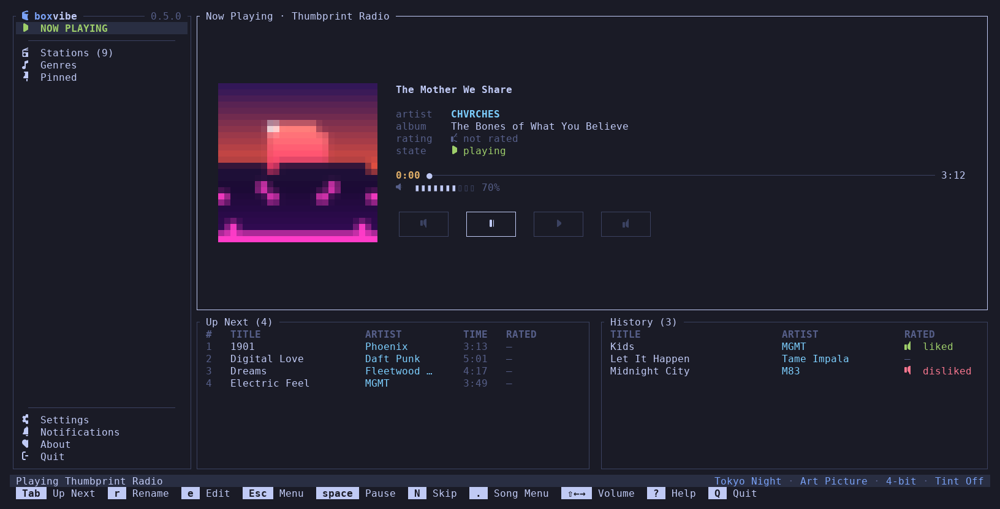
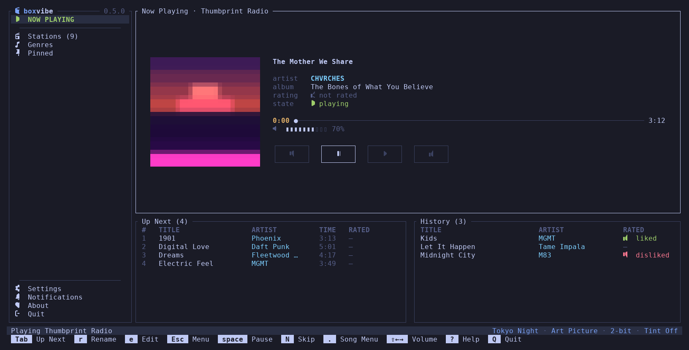
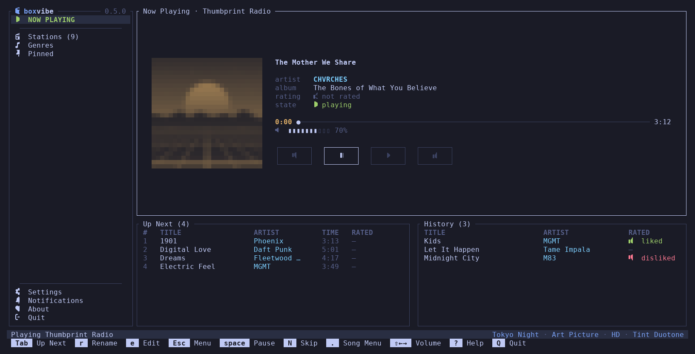
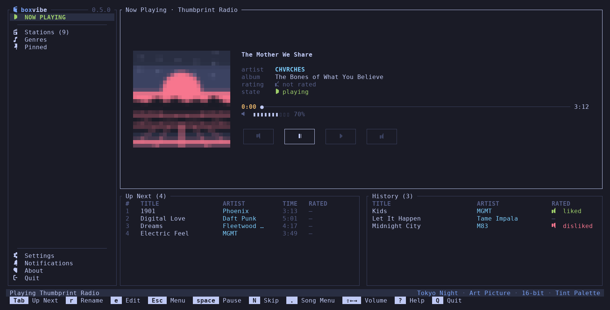
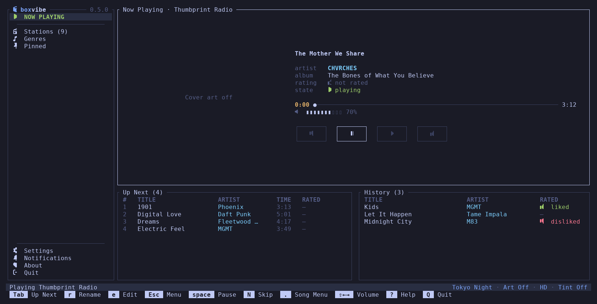
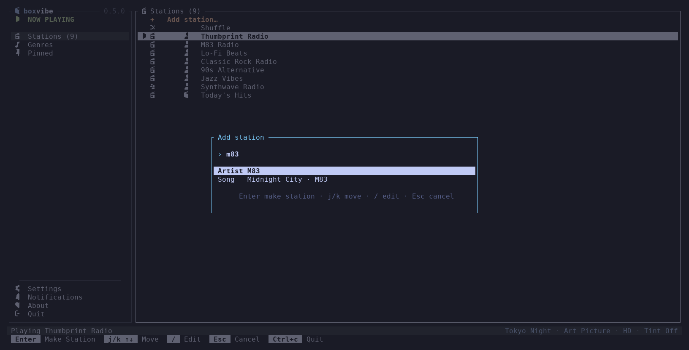
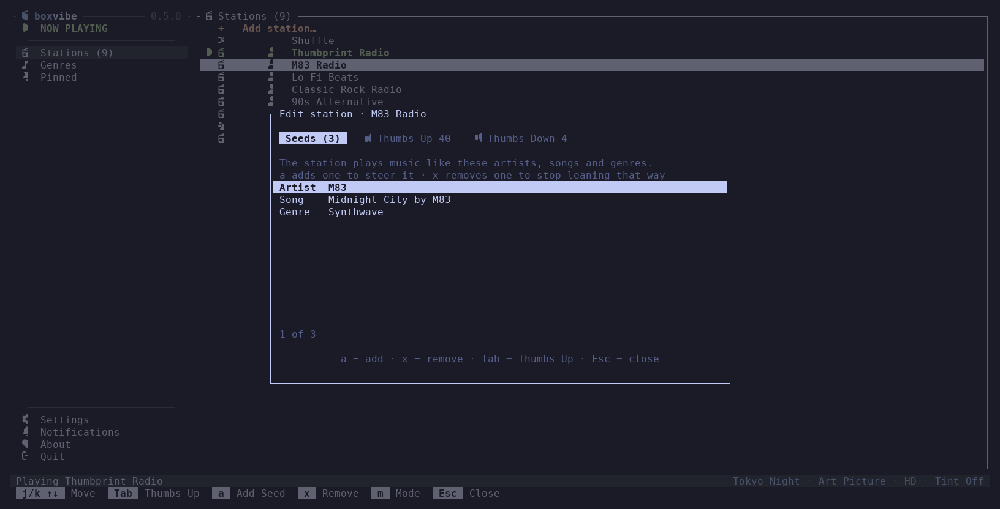
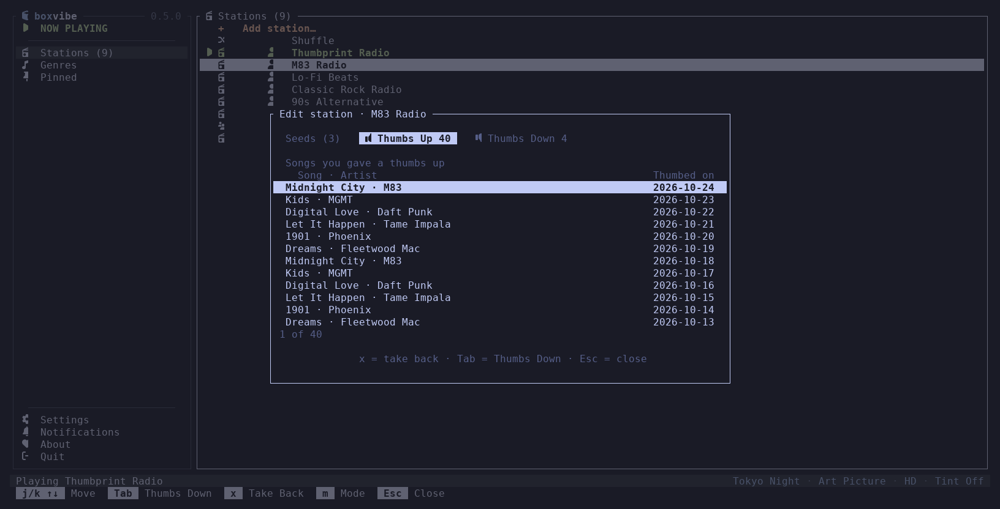
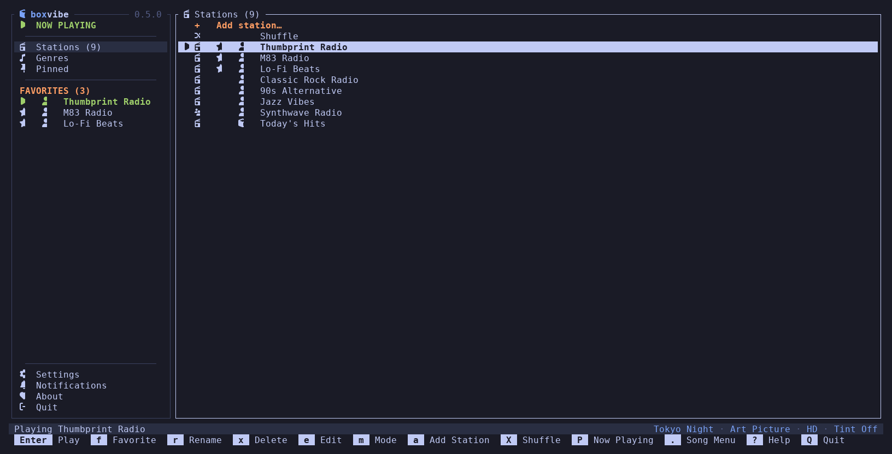
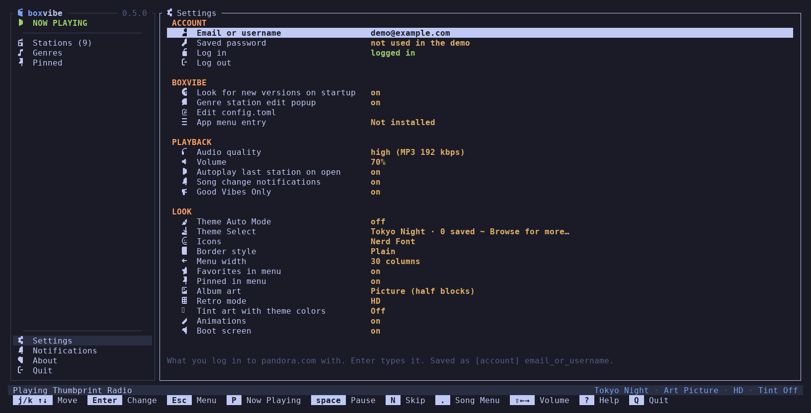

# boxvibe

[](https://github.com/mortbrew/boxvibe/actions/workflows/ci.yml)
[](https://github.com/mortbrew/boxvibe/actions/workflows/codeql.yml)
[](https://github.com/mortbrew/boxvibe/actions/workflows/audit.yml)
[](https://github.com/mortbrew/boxvibe/releases/latest)
[](#license)

**Pandora radio in your terminal.** Your stations, big cover art, thumbs, a
song menu and a station editor, all in a fast, keyboard-driven
[ratatui](https://ratatui.rs) app written in Rust. It follows your Omarchy
theme, draws album art as a real picture (or retro pixels), and keeps itself
up to date.


> Every screenshot here comes from `boxvibe --demo`: made-up stations and songs,
> no Pandora account, no network.

## Why boxvibe

- **A CarPlay-style Now Playing card**: cover, title, artist, album, your
  thumb, progress, volume and four big buttons, with **Up Next** and
  **History** side by side underneath.
- **Your stations, your way**: make one from any artist or song, edit its
  seeds, review and take back thumbs, switch its mode, star favorites.
- **The `.` song menu** puts everything about a song one key away: start a
  station from it, tired of it, share, why it played, similar artists and bio,
  pin it, sleep timer.
- **Looks right everywhere**: follows Omarchy live, 8 built-in themes, ~900
  more one search away, three icon sets, five border styles.
- **No package repository needed**: download one binary and it **updates
  itself** from GitHub releases. It will also be on the **AUR** and as a
  **.deb**.
- **Light on your system**: MP3 and AAC decode in pure Rust. No ffmpeg, no
  mpv, and your password stays in the system keychain.

## Album art, ten ways

boxvibe asks the terminal once what it can draw: **sixel**, **kitty** or
**iTerm2** terminals get a real picture; everything else (and tmux or Zellij)
gets coloured half blocks. Then make it your own: `R` steps **Retro mode**
from HD down to 2-bit pixels, `H` **tints** it with your theme, `C` turns it
off.

| HD | 64-bit | 32-bit |
|---|---|---|
|  |  |  |
| **16-bit** | **8-bit** | **4-bit** |
|  |  |  |
| **2-bit** | **Duotone tint** | **Palette tint (16-bit)** |
|  |  |  |

Retro shrinks the cover to 256, 128, 64, 32, 16 or 8 pixels across and scales
it back up, nearest-neighbour. **Duotone** maps brightness from the theme's
background to its accent; **Palette** snaps every pixel to the nearest theme
colour. Both follow theme changes live. With art off, the card says so:



Covers download in the background and are cached in `~/.cache/boxvibe/art`
(50 MB). A failed one is retried; why it failed goes to
`~/.cache/boxvibe/art.log`, never the screen.

## Make and shape stations

**Create a station** with `a` on the Stations page: type an artist or song,
`Enter` searches, pick a result, and `Enter` makes the station and plays it.



**Edit a station** with `e`. The **Seeds** tab lists the artists, songs and
genres it is built on: `a` adds one to steer it, `x` removes one. The
**Thumbs Up** and **Thumbs Down** tabs list every song you rated on it, and
`x` takes a thumb back. `Tab` cycles the tabs.





`m` switches the station's mode (My Station, Crowd Faves, Discovery, Deep
Cuts, Newly Released, Artist Only), `r` renames, `x` deletes, `v` shows
details, and `G` browses Pandora's genre stations.

## Favorites

`f` stars a station. Starred stations get their own **FAVORITES** section in
the menu, one `Enter` from playing, and `F` jumps there from anywhere.



## Settings

Everything lives on one page in four groups: **ACCOUNT**, **BOXVIBE**,
**PLAYBACK** and **LOOK**. Each row explains itself, and every change is
written to `config.toml` at once, keeping your comments.



Highlights:

- **Theme Auto Mode** follows Omarchy live (the status bar reads
  `omarchy: <Theme Name>`). Turn it off and **Theme Select** fuzzy-searches
  about 900 [iTerm2-Color-Schemes](https://github.com/mbadolato/iTerm2-Color-Schemes)
  plus the built-ins (Tokyo Night, Gruvbox, Catppuccin, Catppuccin Latte,
  Rosé Pine Dawn, Nord, Everforest, Kanagawa). `Enter` downloads and applies.
- **Good Vibes Only** (on by default) plays Pandora's audio ads the way the
  website does, so your account looks like any other listener's. **Muted**
  plays them silently; **Off** skips them, at your own risk (see the popup).
- **Audio quality**: 192 kbps MP3 on Plus / Premium, with Pandora's per-song
  loudness applied.
- **App menu entry** adds boxvibe to your app launcher.

## Install

### One binary that updates itself

boxvibe works without any package repository. Grab
`boxvibe-<arch>-linux.tar.gz` (x86_64 or aarch64) from the
[latest release](https://github.com/mortbrew/boxvibe/releases/latest):

```sh
tar xzf boxvibe-x86_64-linux.tar.gz
install -Dm755 boxvibe ~/.local/bin/boxvibe
boxvibe
```

From then on it **updates itself**: at startup it asks GitHub for the latest
release, and **About → Update Now** downloads it, checks it runs, swaps it in
place and offers **Restart Now**. Turn the check off with
`look_for_new_versions_on_startup = false`.

**Coming soon:** an **AUR** package for Arch / Omarchy and a **.deb** for
Debian and Ubuntu. When a package manager installed boxvibe, About still tells
you about a new version but leaves updating to the package manager.

### Build from source

```sh
sudo pacman -S --needed rust alsa-lib pkgconf     # or rustup; Rust 1.90+
git clone https://github.com/mortbrew/boxvibe && cd boxvibe
cargo build --release
./target/release/boxvibe --demo                   # try it with no account
```

Debian / Ubuntu need `libasound2-dev pkg-config`; Fedora needs
`alsa-lib-devel pkgconf-pkg-config`.

### Requirements

- Linux with ALSA (PipeWire's or PulseAudio's ALSA bridge is fine).
- A Pandora account, free or paid. Pandora only works in the US.
- Optional: a [Nerd Font](https://www.nerdfonts.com) for the default icons,
  `notify-send` for song notifications, and a Secret Service keychain (GNOME
  Keyring, KeePassXC…) to remember your password.

At start, a **System Check** looks for the font and `notify-send` and names
the package to install if one is missing. boxvibe installs nothing itself.

## First run

boxvibe opens **Settings** at ACCOUNT: type your Pandora email, then your
password in a popup. The password goes to your desktop keychain, never to a
file. From then on boxvibe logs in by itself and starts your last station.

## Keys

Shift+letter goes places from anywhere; lowercase acts on the pane you're in.
The bottom bar shows what works right now, and `?` lists everything.

| Key | Action |
|---|---|
| `space` / `p` · `N` | play / pause · skip |
| `U` `D` · `l` `b` | thumbs up / down the playing song · the selected row (again takes it back) |
| `Z` | tired of this song |
| `.` | song menu |
| `Shift+←` `Shift+→` | volume |
| `j` `k` `↑` `↓` · `Tab` · `Esc` | move · next pane · back to the menu |
| `P` `S` `G` `O` `A` `F` | Now Playing, Stations, Genres, Settings, About, Favorites |
| `a` `e` `r` `x` `v` `m` | add, edit, rename, delete, details, mode for a station |
| `f` · `I` · `X` | favorite a station · pin a song · Shuffle |
| `C` `R` `H` | album art on / off · Retro level · tint |
| `B` | sleep timer |
| `{` `}` | menu narrower / wider |
| `?` · `Q` / `Ctrl+c` | help · quit (asks) / quit now |

Media keys and `playerctl` work too, through MPRIS.

## Configuration

`~/.config/boxvibe/config.toml` (`--config FILE` picks another one). Every key
is optional, and the app writes the ones you change from it. Keys this version
doesn't know (a typo, a leftover from testing, an old `[pandora]` key from the
JSON-API boxvibe, or a setting from a newer boxvibe) and values of the wrong
type are skipped with a warning in the status bar. Nothing in the file can stop
boxvibe from starting: one that is not valid TOML is moved to
`config.toml.bad-<UTC time>` and boxvibe starts with the defaults and says so.

```toml
# The tables are the Settings groups (ACCOUNT, BOXVIBE, PLAYBACK and LOOK) and each
# key is the Settings row's label in lower case, with underscores.
[account]
email_or_username = "you@example.com"   # Settings → Email or username
user_agent = ""                # empty: boxvibe's default (a desktop Firefox); see below

[boxvibe]
look_for_new_versions_on_startup = true   # Settings → Look for new versions on startup: ask GitHub for a new release
genre_edit_popup = true        # true: renaming or editing a genre station opens a popup that says why; its
                               # "Don't show this again" box (or Settings → Genre station edit popup) sets false

[playback]
audio_quality = "high"         # high: MP3 192 kbps if your plan has it (Plus, Premium), else 128
                               # standard: MP3 128 kbps (old low / medium values mean standard)
volume = 70                    # 0–100
song_change_notifications = true   # Settings → Song change notifications: a desktop notification when the song changes (Settings toggles it)
autoplay_last_station = true   # start the station played last when boxvibe opens
good_vibes_only = true         # Settings → Good Vibes Only: true plays Pandora's audio ads and reports them, like the website does; "muted" does the same at volume 0; false skips ads
last_station = ""              # the station to start on, kept by the app
favorites = []                 # starred stations, { id = "…", name = "…" }, set with f

[look]
theme_auto_mode = "omarchy"    # omarchy (follow the Omarchy theme) | off (use theme_select)
                               # (the first run: omarchy on an Omarchy system, else off)
theme_select = "tokyo-night"   # tokyo-night | gruvbox | catppuccin | catppuccin-latte
                               # | rose-pine | nord | everforest | kanagawa
                               # | a scheme saved in ~/.config/boxvibe/themes/ (by file name)
icons = "nerd"                 # nerd | emoji | unicode
border_style = "plain"         # plain | rounded | thick | double | none
menu_width = 30                # the menu, in columns: 20–40, step 2 (at most half the screen); also { and }
favorites_in_menu = true       # Settings → Favorites in menu: false hides FAVORITES from the menu (kept; f still stars)
pinned_in_menu = true          # Settings → Pinned in menu: false hides the Pinned entry (Shift+I still pins)
album_art = "picture"          # picture | off
retro_mode = "hd"              # hd | 64bit | 32bit | 16bit | 8bit | 4bit | 2bit (full / 256 / 128 / 64 / 32 / 16 / 8 px, blocky on purpose)
tint_art_with_theme_colors = "off"   # Settings → Tint art with theme colors: off | duotone | palette: recolour the cover with the theme's colours
animations = true              # false: no motion (the 2 second boot screen is skipped); Settings → LOOK → Animations
boot_screen = true             # Settings → Boot screen: the 2 second boxvibe boot screen (any key skips it)
```

The 0.1–0.3 files had `[pandora]`, `[player]` and `[ui]` tables. They still
load, and the next time the app saves something it moves each key into its
group above (comments, also the ones above a key, and the rest of the file stay).
Some keys were renamed to match their Settings row, and the old names still read too:
`username` is now `email_or_username`, `check_updates` is `look_for_new_versions_on_startup`,
`notify` and `notifications` are `song_change_notifications`, `art_tint` is
`tint_art_with_theme_colors`, `splash` (in `[boxvibe]` or `[look]`) is `boot_screen`
and `good_guy` is `good_vibes_only`. The old `theme` key becomes `theme_auto_mode = "omarchy"`, or `theme_auto_mode = "off"` plus `theme_select`. The next save writes the new name and removes the
old one, never both (if a file has both, the new one wins). Keys boxvibe doesn't know are
kept and skipped with a warning. Settings → each setting's
description in the box below the list says where it is saved.

*Dev note: this old-name migration (the old tables and old key names) is slated for removal at 1.0; it lives in `src/config.rs`, marked `REMOVE AT 1.0`.*

`--theme NAME` and `--icons SET` change them for one run without saving.
A bad `album_art`, `retro_mode` or `tint_art_with_theme_colors` value is ignored with a warning (picture / hd / off).
The old `album_art = "blocks"` reads as `picture` (half blocks are what Picture uses when the terminal has no graphics).
The 0.3 betas' `art_pixelation` key (off / extra_low / low / medium / high / max) still reads as `retro_mode`.

## How it talks to Pandora

boxvibe uses the same API as the pandora.com website
(`https://www.pandora.com/api/`), written from the community
[API notes](https://6xq.net/pandora-apidoc/rest/) and how the site behaves,
with parts adapted from [Music Assistant](https://github.com/music-assistant/server)'s
Pandora provider (Apache-2.0, see [THIRD_PARTY.md](THIRD_PARTY.md)). It logs
in with your email and password, fetches a few songs at a time, sends thumbs
and "song started" just like the site, logs in again when the session
expires, and takes over playback if another device is using your account.

## Screenshots

The images in `docs/screenshots/` are drawn from demo mode at 160×40 in Tokyo
Night, with a made-up cover:

```sh
cargo test --release screenshots -- --ignored   # writes target/screenshots/*.json
python3 scripts/screenshots.py                  # draws docs/screenshots/*.png
```

## Development

```sh
cargo test
cargo clippy --all-targets -- -D warnings
cargo fmt --check
cargo build --release
```

Tests run in demo mode or against a fake server, never live Pandora.

## Disclaimer

boxvibe is not made by or affiliated with Pandora. It uses an unofficial API,
which may go against Pandora's Terms of Service; use it at your own risk.
Your password is kept in your desktop's Secret Service keychain, not in
`config.toml`. An older `config.toml` with a plain `password = "…"` line is
read once: after a login works the password moves to the keychain and the line
is removed from the file (if there is no keychain it stays in the file, which
only you can read, and boxvibe warns you).

## License

Licensed under either of [Apache License, Version 2.0](LICENSE-APACHE) or
[MIT license](LICENSE-MIT), at your option. Parts of the Pandora code are
adapted from Music Assistant (Apache-2.0): see [THIRD_PARTY.md](THIRD_PARTY.md).

